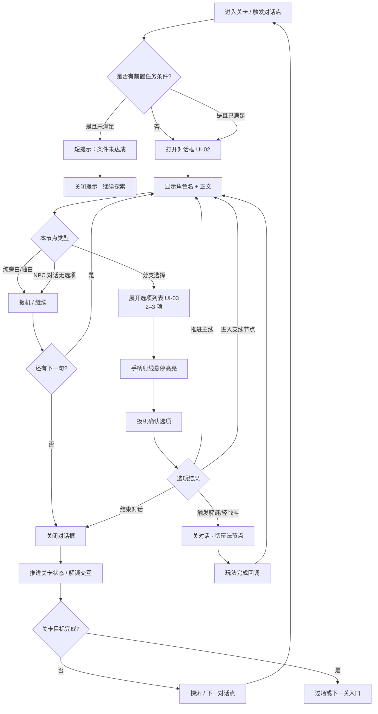
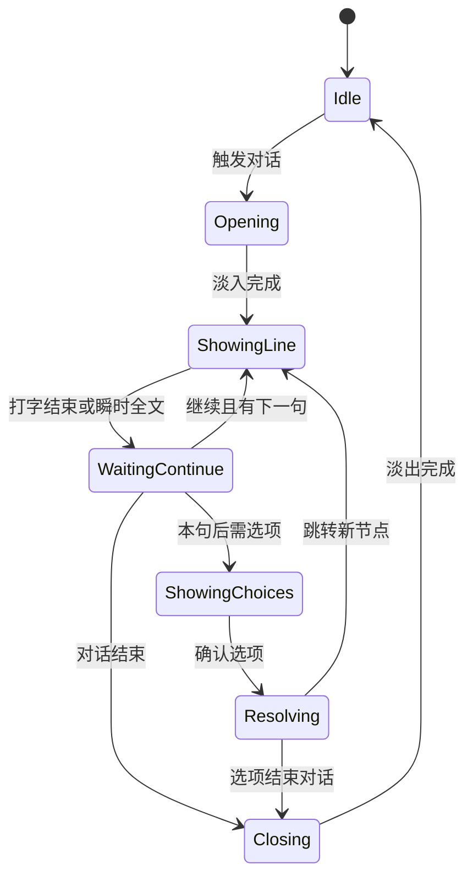

# VRgame · 对话与分支逻辑流程图（首版）

> 风格：古剑奇谭气质 · PCVR 世界锚对话框 + 射线选选项  
> 对应界面：UI-02 对话框 / UI-03 分支选项

## 主流程

## 单句对话状态机（给程序）

## 文案与 UI 约束（跟流程图绑定）

| 项 | 建议上限 |
|----|----------|
| 单句正文 | ≤ 40 字（VR 可读） |
| 选项条数 | 2–3 |
| 单选项文案 | ≤ 12 字 |
| 角色名 | ≤ 6 字 |

## 文件

本图：`/workspace/VRgame/docs/UI对话分支流程图.md`
