# 美术资源说明（秦朝山海经 · 古剑气质）
> 日期：2026-11-04 · 主责：策划 · 状态：draft · 原画共 **46** 张  
> 平台：PCVR · Unity · VR 舒适（忌贴脸瞬闪、忌全屏闪）  
> 对照总表：`美术资源总表.csv`；命名：`ART_concept_*`（概念原画）  
> 原画根：`docs/关卡概念/原画/` · 稳定预览：`docs/美术/preview/`

---

## 一、主角与武器靴

正式甲以 **金黄龙纹** 为准；玄红旅装为气质变体。对接 `CHAR_player_swordsman`。VR：身高 **180cm** 锚；手持剑碰撞简盒；披风/衣摆可用低成本布料或硬折面。

### `ART_concept_player_qin_portrait` · 秦服剑士立绘·玄红旅装

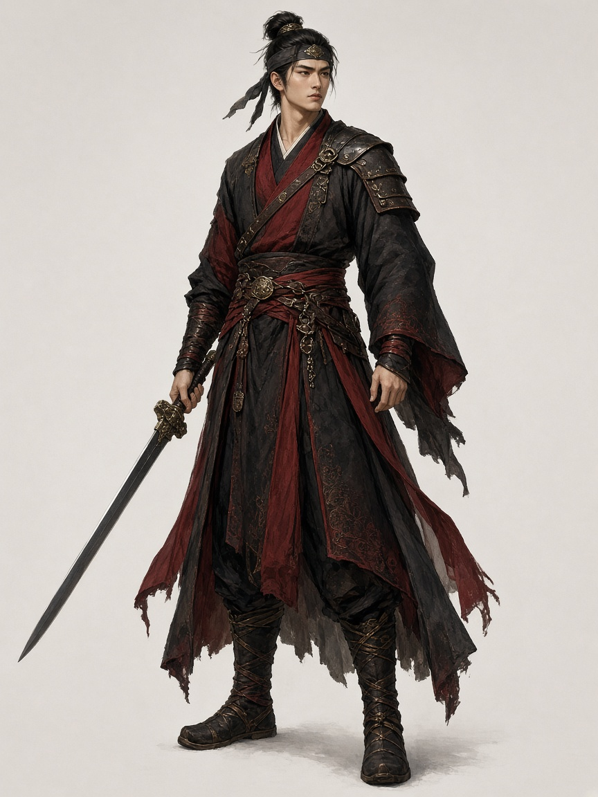

男·约21岁·身高180锚；玄黑劲装+朱红内衬/腰带；左肩叠甲、腕甲、青铜饕餮带扣；持直剑；面容清峻发髻玄冠。材质：做旧皮革/青铜/麻布毛边。气质：秦驿夜行斩妖剑客（旅装变体，与金黄龙纹甲并存）。

- 路径：`docs/关卡概念/原画/角色_秦服剑士_男_21岁180.jpg`（864x1152）  
- 用途：主角立绘参考；CHAR_player_swordsman 造型A  
- 制作：主角全身低模目标约 **8k–15k tris**（头显可读）；靴/剑可拆 PROP；贴图 2K 主、远距 1K。

### `ART_concept_player_gold_dragon` · 主角·金黄龙纹高颧骨立绘

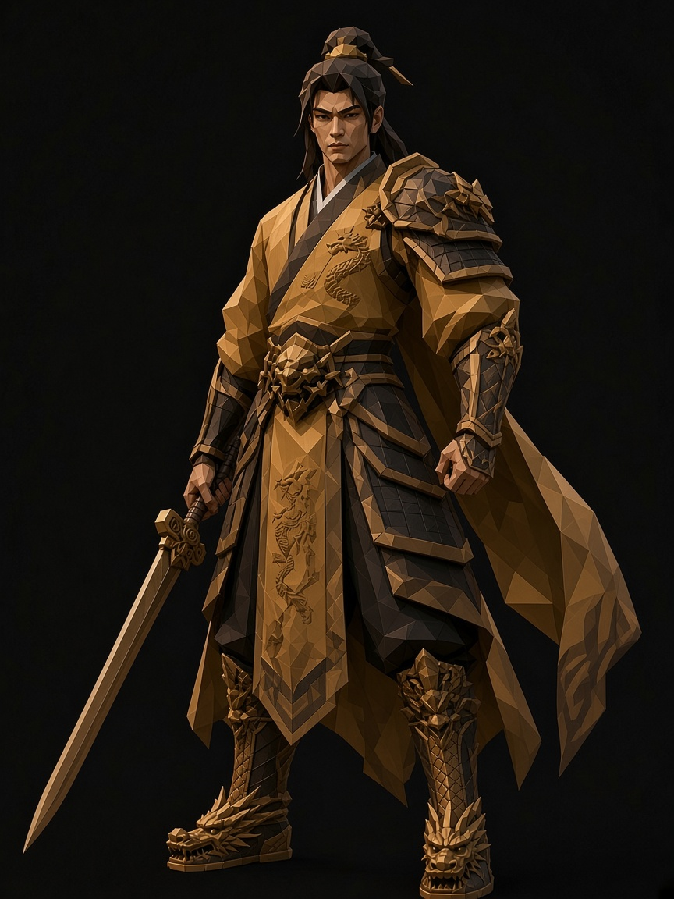

低模棱面风；金/暗铜甲；高颧骨锐脸；左肩龙首甲、饕餮带、垂龙纹蔽膝、龙首靴；持秦王剑形；黑底。材质：暗金金属+硬折披风。正式斩妖甲定稿主参考。

- 路径：`docs/关卡概念/原画/主角_金黄龙纹_高颧骨.jpg`（864x1152）  
- 用途：主角正式甲造型B；VR avatar 低模目标  
- 制作：主角全身低模目标约 **8k–15k tris**（头显可读）；靴/剑可拆 PROP；贴图 2K 主、远距 1K。

### `ART_concept_player_gold_dragon_3view` · 主角·金黄龙纹高颧骨三视图

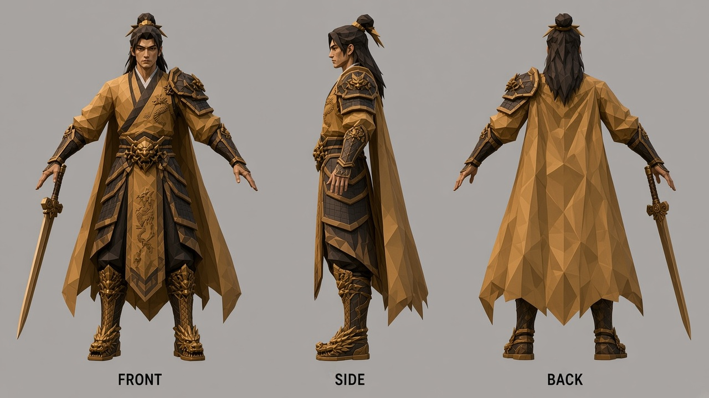

正/侧/背三视图；同金黄龙纹甲；比例锁头身与披风轮廓；供建模对比例。

- 路径：`docs/关卡概念/原画/主角_金黄龙纹_高颧骨_三视图.jpg`（1280x720）  
- 用途：建模三视图  
- 制作：主角全身低模目标约 **8k–15k tris**（头显可读）；靴/剑可拆 PROP；贴图 2K 主、远距 1K。

### `ART_concept_player_gold_lowpoly` · 主角·秦服剑士金黄龙纹低模

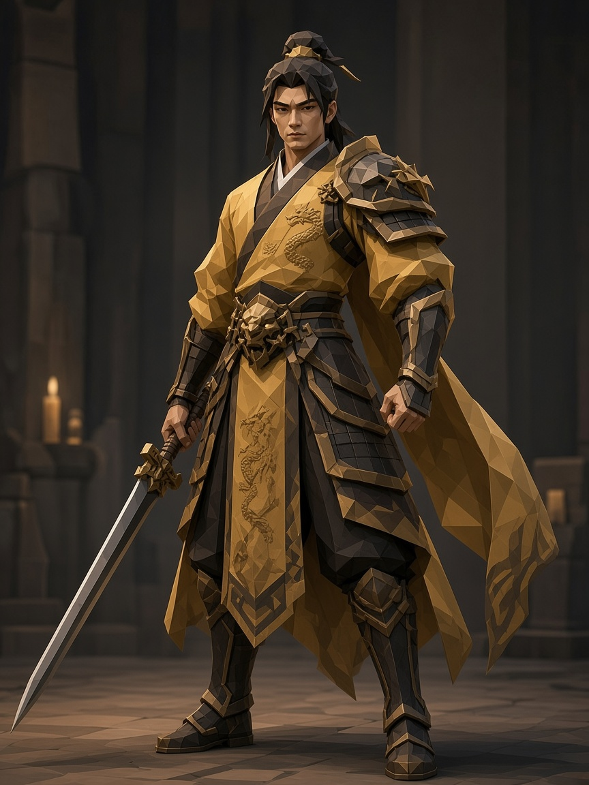

低多边形体块明确；金黄龙纹甲面片清晰；便于估面数与轮廓识别。

- 路径：`docs/关卡概念/原画/主角_秦服剑士_金黄龙纹_低模.jpg`（864x1152）  
- 用途：低模面数/轮廓验收  
- 制作：主角全身低模目标约 **8k–15k tris**（头显可读）；靴/剑可拆 PROP；贴图 2K 主、远距 1K。

### `ART_concept_player_heaven_eye` · 主角·金黄龙纹天眼变体

*原图：* `../关卡概念/原画/主角_金黄龙纹_天眼.jpg`

额前天眼（或天眼意象）变体；同金黄龙纹甲；强调山海经异能可读点，勿做成赛博HUD。

- 路径：`docs/关卡概念/原画/主角_金黄龙纹_天眼.jpg`（864x1152）  
- 用途：特异值/天眼演出可选皮  
- 制作：主角全身低模目标约 **8k–15k tris**（头显可读）；靴/剑可拆 PROP；贴图 2K 主、远距 1K。

### `ART_concept_player_sword_pose` · 主角·持秦王剑形金黄龙纹

*原图：* `../关卡概念/原画/主角_持秦王剑形_金黄龙纹.jpg`

持剑姿态特写；剑形制对齐 PROP 秦王剑；甲色金黄龙纹。

- 路径：`docs/关卡概念/原画/主角_持秦王剑形_金黄龙纹.jpg`（864x1152）  
- 用途：武器握持/待机姿态  
- 制作：主角全身低模目标约 **8k–15k tris**（头显可读）；靴/剑可拆 PROP；贴图 2K 主、远距 1K。

### `ART_concept_player_dragon_boots` · 主角·龙形靴金黄龙纹

*原图：* `../关卡概念/原画/主角_龙形靴_金黄龙纹.jpg`

全身强调龙首靴与下摆；金黄龙纹连贯；靴口龙吻含足尖。

- 路径：`docs/关卡概念/原画/主角_龙形靴_金黄龙纹.jpg`（864x1152）  
- 用途：靴+下身比例  
- 制作：主角全身低模目标约 **8k–15k tris**（头显可读）；靴/剑可拆 PROP；贴图 2K 主、远距 1K。

### `ART_concept_prop_qin_sword` · 道具·秦王剑形制低模

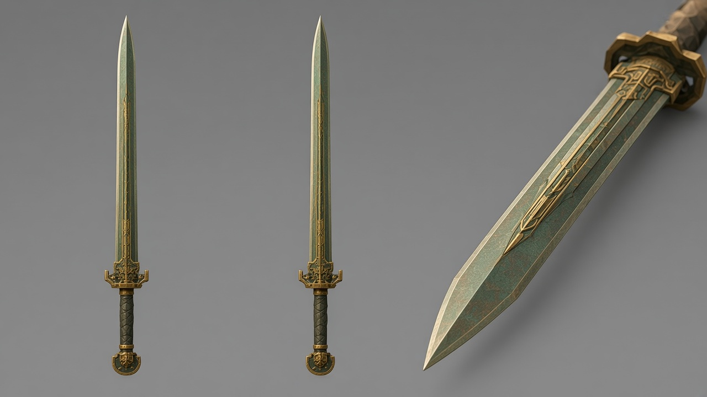

直刃秦剑低模；青铜护手云纹/兽纹；刃截面清晰。材质古铜+钢灰。VR：手持碰撞简盒，刃长约玩家臂展可读。

- 路径：`docs/关卡概念/原画/道具_秦王剑形制_低模.jpg`（1280x720）  
- 用途：PROP 武器主参考；握持对齐主角  
- 制作：主角全身低模目标约 **8k–15k tris**（头显可读）；靴/剑可拆 PROP；贴图 2K 主、远距 1K。

### `ART_concept_prop_dragon_boots_3view` · 道具·龙形靴三视图

*原图：* `../关卡概念/原画/道具_龙形靴_三视图.jpg`

龙首靴正侧背；鳞片与口吻结构；暗金。

- 路径：`docs/关卡概念/原画/道具_龙形靴_三视图.jpg`（1280x720）  
- 用途：PROP/角色靴建模  
- 制作：主角全身低模目标约 **8k–15k tris**（头显可读）；靴/剑可拆 PROP；贴图 2K 主、远距 1K。

## 二、NPC · 鬼怪 / 半甲 / 牛头 / 蛇形大BOSS

对接 `NPC技能与动作动画.md`：`N_ghost` / `N_ghost_armor` / `E_minotaur` / `B_serpent`。鬼怪靠 **影子预警**；牛头冲撞给侧向逃点；蛇甩尾预警 ≥0.35s。

### `ART_concept_ghost_3view` · NPC鬼怪三视图

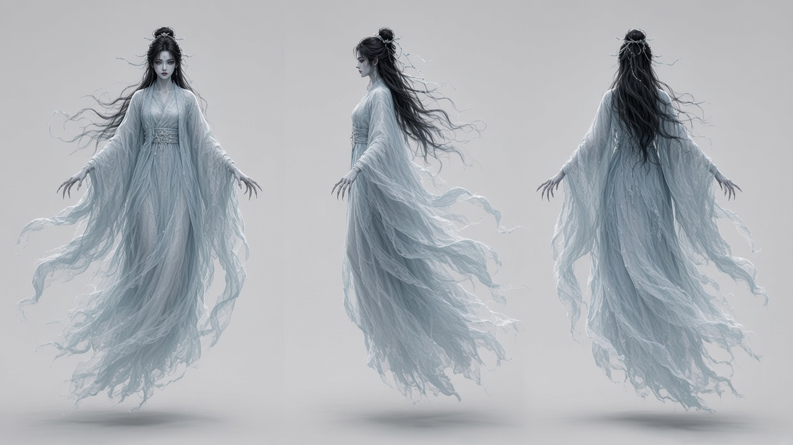

半透明女形怨影；冷青灰；下摆雾化无实脚；利爪；漂浮。N_ghost 体态锁定。

- 路径：`docs/关卡概念/原画/NPC_鬼怪_三视图.jpg`（1280x720）  
- 用途：N_ghost 建模三视图  
- 制作：杂兵 **4k–8k tris**；半透明+下摆粒子；地面影独立贴花/Blob；扑杀最短停距 ≥1.2m。

### `ART_concept_ghost_armor_3view` · NPC半甲鬼怪三视图

*原图：* `../关卡概念/原画/NPC_鬼怪_半甲_三视图.jpg`

同族+半甲；甲缘可读；N_ghost_armor。

- 路径：`docs/关卡概念/原画/NPC_鬼怪_半甲_三视图.jpg`（1280x720）  
- 用途：N_ghost_armor 三视图  
- 制作：杂兵 **4k–8k tris**；半透明+下摆粒子；地面影独立贴花/Blob；扑杀最短停距 ≥1.2m。

### `ART_concept_ghost_armor_gold_lowpoly` · NPC半甲金边鬼怪低模

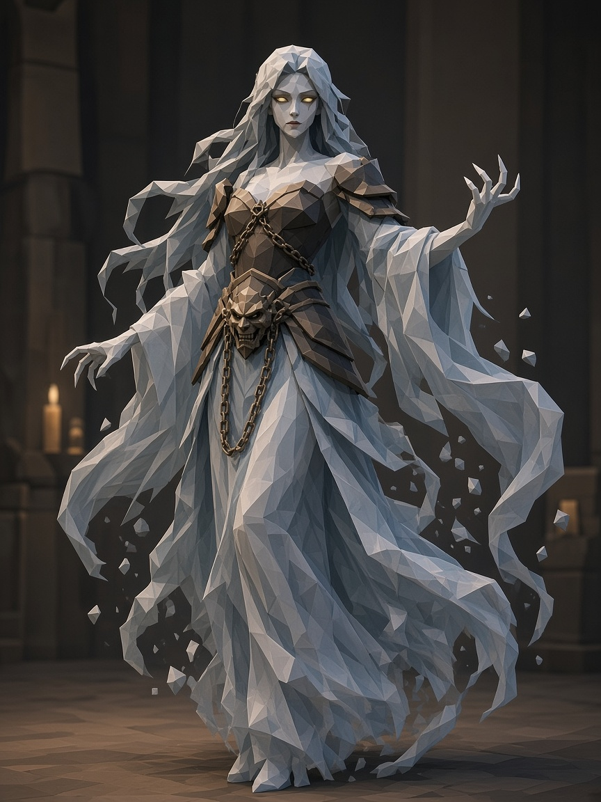

棱面低模；冰白/冷灰袍碎裂漂浮；胸肩暗青铜甲；饕餮带+垂链；黄瞳无眸；石殿烛火背景。材质：晶石碎面+古铜。

- 路径：`docs/关卡概念/原画/NPC_鬼怪_半甲金边_低模.jpg`（864x1152）  
- 用途：N_ghost_armor 低模主参考  
- 制作：杂兵 **4k–8k tris**；半透明+下摆粒子；地面影独立贴花/Blob；扑杀最短停距 ≥1.2m。

### `ART_concept_ghost_shadow_seq` · NPC鬼怪移动序列影子

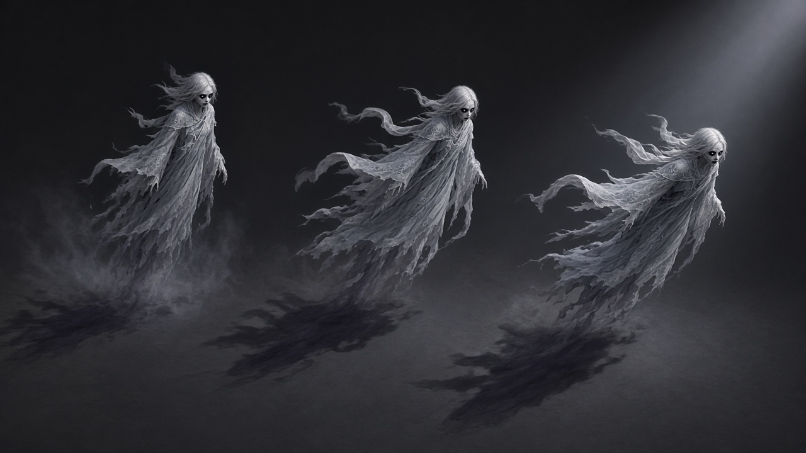

三段滑翔：起浮→前倾滑→扑杀前倾；地面影滞后0.1–0.2s；扑击影拉长（ShadowStretch）。

- 路径：`docs/关卡概念/原画/NPC_鬼怪_移动序列影子.jpg`（1280x720）  
- 用途：动画/预警教学；对齐 ANIM_ghost_move_*  
- 制作：杂兵 **4k–8k tris**；半透明+下摆粒子；地面影独立贴花/Blob；扑杀最短停距 ≥1.2m。

### `ART_concept_ghost_shadow_closeup` · NPC鬼怪移动影子特写

*原图：* `../关卡概念/原画/NPC_鬼怪_移动影子特写.jpg`

影与身体错位特写；强调可读预兆，忌瞬闪。

- 路径：`docs/关卡概念/原画/NPC_鬼怪_移动影子特写.jpg`（1280x720）  
- 用途：影子系统说明图  
- 制作：杂兵 **4k–8k tris**；半透明+下摆粒子；地面影独立贴花/Blob；扑杀最短停距 ≥1.2m。

### `ART_concept_minotaur` · NPC牛头怪概念立绘

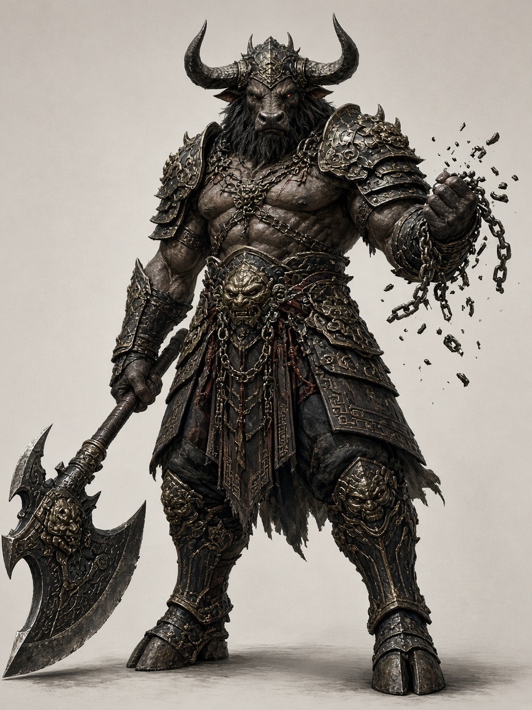

牛首人身精英；石灰肤+黑鬃；青铜兽面盔全角；胸链交叉；饕餮带；巨斧；蹄铁；碎链动能。色：暗灰+古铜+红瞳。VR身高约2.8–3.5m威压。

- 路径：`docs/关卡概念/原画/NPC_牛头怪_概念.jpg`（864x1152）  
- 用途：E_minotaur 概念主图  
- 制作：精英 **12k–20k tris**；身高约 2.8–3.5m；斧扫禁贴脸大甩头；前摇 ≥0.35s。

### `ART_concept_minotaur_3view` · NPC牛头怪三视图

*原图：* `../关卡概念/原画/NPC_牛头怪_三视图.jpg`

正侧背；斧/链比例；蹄铁轮廓。

- 路径：`docs/关卡概念/原画/NPC_牛头怪_三视图.jpg`（1280x720）  
- 用途：E_minotaur 建模  
- 制作：精英 **12k–20k tris**；身高约 2.8–3.5m；斧扫禁贴脸大甩头；前摇 ≥0.35s。

### `ART_concept_minotaur_broken_horn_lowpoly` · NPC牛头怪半甲破旧断角低模

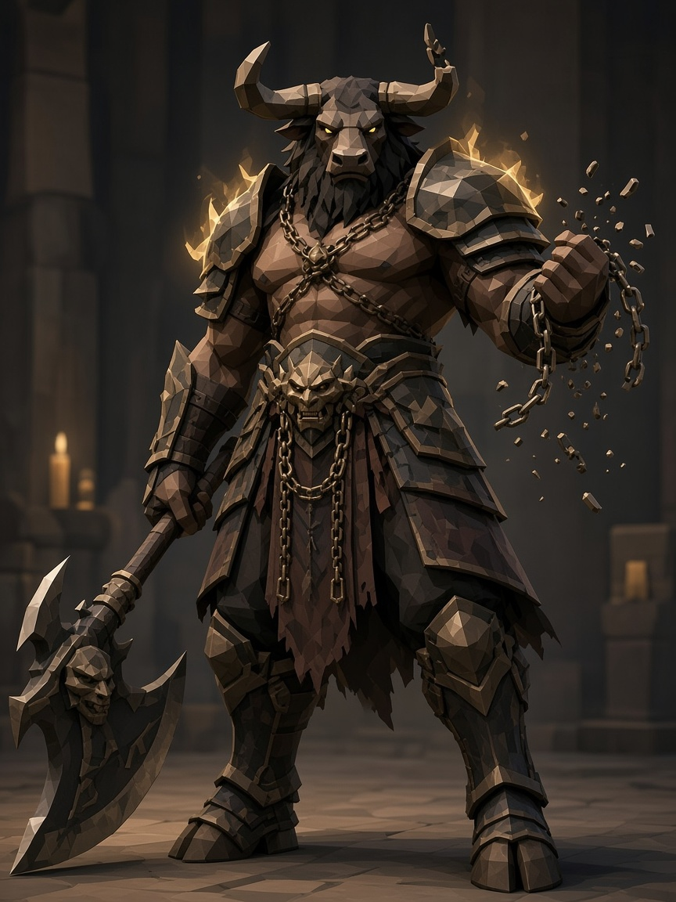

断角变体+破旧半甲；低模面片；关卡门卫磨损感。

- 路径：`docs/关卡概念/原画/NPC_牛头怪_半甲破旧断角_低模.jpg`（864x1152）  
- 用途：E_minotaur 低模/断角皮  
- 制作：精英 **12k–20k tris**；身高约 2.8–3.5m；斧扫禁贴脸大甩头；前摇 ≥0.35s。

### `ART_concept_serpent_full` · 大BOSS蛇形无角全身

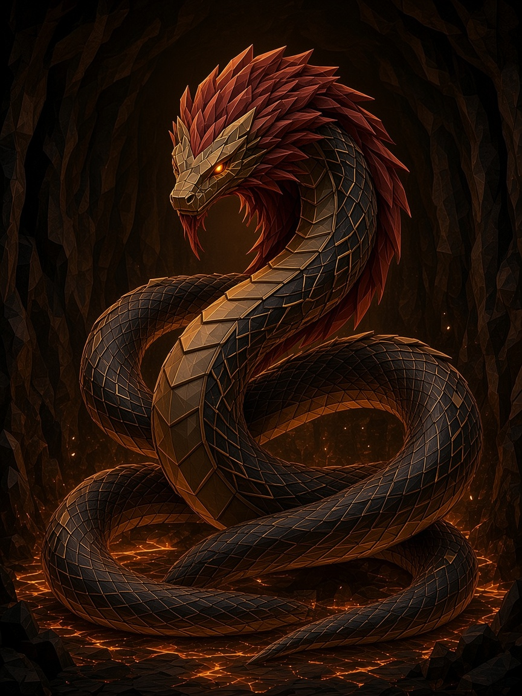

无角大蛇盘S；炭灰几何鳞+金腹甲；赤红鬣；橙瞳；岩浆底光洞窟。化蛇/巴蛇意象。舞台级体量。

- 路径：`docs/关卡概念/原画/大BOSS_蛇形怪物_无角全身.jpg`（864x1152）  
- 用途：B_serpent 概念主图  
- 制作：Boss 分段骨骼/盘绕舞台；高模区域在头鬣与金腹；岩浆底光用 LIT，忌全屏闪。

### `ART_concept_serpent_3view` · 大BOSS蛇形三视图

*原图：* `../关卡概念/原画/大BOSS_蛇形怪物_三视图.jpg`

盘绕/昂首比例；鬣与腹甲分区。

- 路径：`docs/关卡概念/原画/大BOSS_蛇形怪物_三视图.jpg`（1280x720）  
- 用途：B_serpent 建模  
- 制作：Boss 分段骨骼/盘绕舞台；高模区域在头鬣与金腹；岩浆底光用 LIT，忌全屏闪。

## 三、四层场景（L01 高山 → L04 洞府）

层主键 `L01`–`L04`；ENV：`ENV_L01_Mountain` / `ENV_L02_Bridge` / `ENV_L03_Magma` / `ENV_L04_Grotto`。**本周试玩主线是驿站 `ENV_Inn_*`，四层关后置**，本表仍完整归档概念。

| 层 | 气质 | 关键概念 id |
|----|------|------------|
| L01 | 冷月、洞口火把、峰亭、瀑布雾 | `ART_concept_L01_clear` |
| L02 | 断崖石桥、门楼、水雾 | `ART_concept_L02_clear` |
| L03 | 熔岩脉、封印门、热压迫 | `ART_concept_L03_clear` |
| L04 | 暖烛洞府、祭坛舞台 | `ART_concept_L04_clear` |

### `ART_concept_L01_clear` · 清晰关卡01·高山

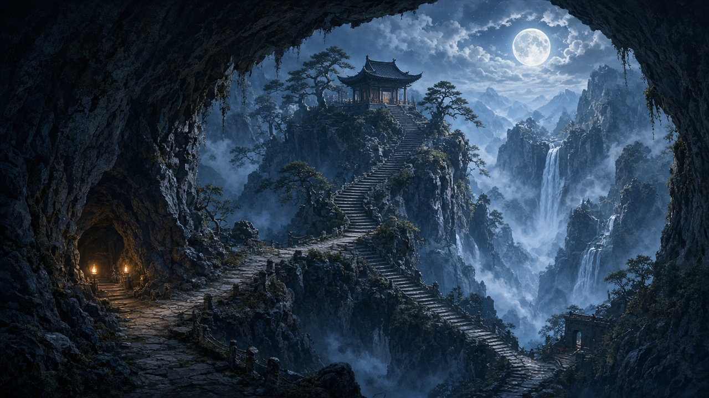

洞口望月下山径：前景岩洞火把、石桥木栏、盘山阶、峰顶亭、黄山松、瀑布雾、满月冷蓝vs烛火暖橙。ENV_L01_Mountain。

- 路径：`docs/关卡概念/原画/清晰关卡01_高山.jpg`（1280x720） · 用途：L01 主氛围概念
- 制作：近景岩/建筑 2K；远峰/雾板低模+雾卡；门洞净宽跟场景规范；传送点 `AN_Teleport_*`。

### `ART_concept_L02_clear` · 清晰关卡02·石桥

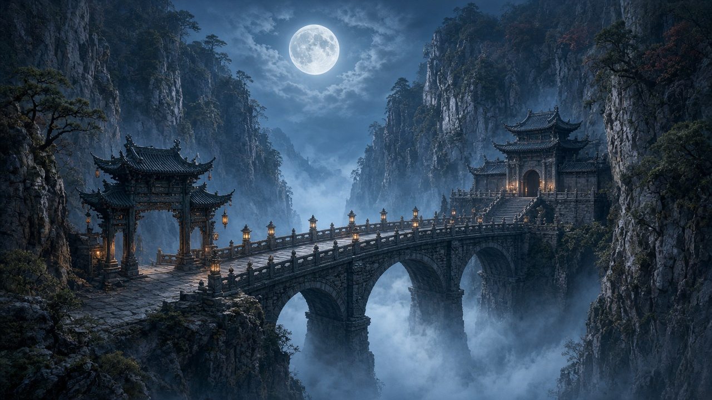

石桥厅：断崖桥面、门楼、水雾桥隙风；冷石与夜雾。ENV_L02_Bridge。

- 路径：`docs/关卡概念/原画/清晰关卡02_石桥.jpg`（1280x720） · 用途：L02 主氛围
- 制作：近景岩/建筑 2K；远峰/雾板低模+雾卡；门洞净宽跟场景规范；传送点 `AN_Teleport_*`。

### `ART_concept_L03_clear` · 清晰关卡03·岩浆

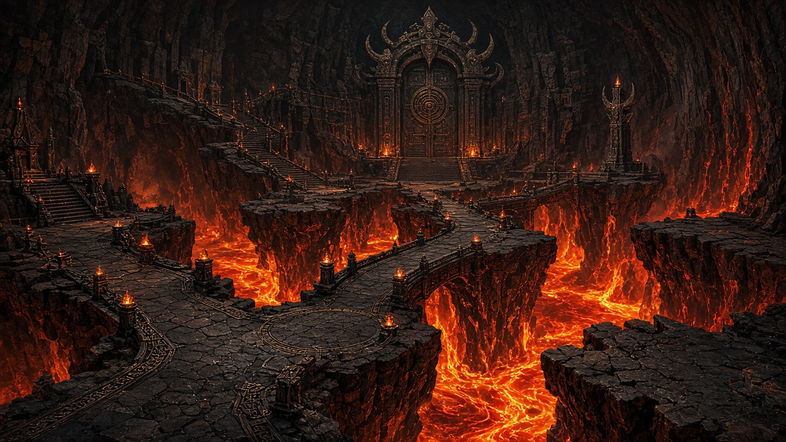

岩浆窟：玄武裂隙、熔岩脉、封印门暖底光；压迫热感但仍控眩光。ENV_L03_Magma。

- 路径：`docs/关卡概念/原画/清晰关卡03_岩浆.jpg`（1280x720） · 用途：L03 主氛围
- 制作：近景岩/建筑 2K；远峰/雾板低模+雾卡；门洞净宽跟场景规范；传送点 `AN_Teleport_*`。

### `ART_concept_L04_clear` · 清晰关卡04·洞府

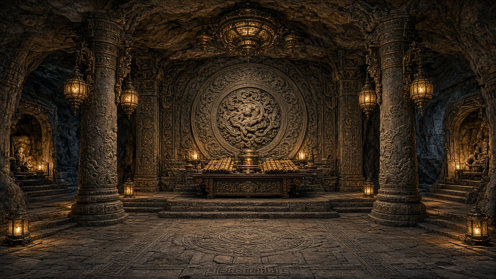

洞府殿：暖烛、祭坛、回声空间；终局庄严。ENV_L04_Grotto。

- 路径：`docs/关卡概念/原画/清晰关卡04_洞府.jpg`（1280x720） · 用途：L04 主氛围
- 制作：近景岩/建筑 2K；远峰/雾板低模+雾卡；门洞净宽跟场景规范；传送点 `AN_Teleport_*`。

### `ART_concept_L01_level` · 关卡01·高山

高山层构图变体；同L01冷月山径气质。

- 路径：`docs/关卡概念/原画/关卡01_高山.jpg`（1280x720） · 用途：L01 构图备选
- 制作：近景岩/建筑 2K；远峰/雾板低模+雾卡；门洞净宽跟场景规范；传送点 `AN_Teleport_*`。

### `ART_concept_L02_level` · 关卡02·石桥

石桥层构图变体。

- 路径：`docs/关卡概念/原画/关卡02_石桥.jpg`（1280x720） · 用途：L02 构图备选
- 制作：近景岩/建筑 2K；远峰/雾板低模+雾卡；门洞净宽跟场景规范；传送点 `AN_Teleport_*`。

### `ART_concept_L03_level` · 关卡03·岩浆

岩浆层构图变体。

- 路径：`docs/关卡概念/原画/关卡03_岩浆.jpg`（1280x720） · 用途：L03 构图备选
- 制作：近景岩/建筑 2K；远峰/雾板低模+雾卡；门洞净宽跟场景规范；传送点 `AN_Teleport_*`。

### `ART_concept_L04_level` · 关卡04·洞府

洞府层构图变体。

- 路径：`docs/关卡概念/原画/关卡04_洞府.jpg`（1280x720） · 用途：L04 构图备选
- 制作：近景岩/建筑 2K；远峰/雾板低模+雾卡；门洞净宽跟场景规范；传送点 `AN_Teleport_*`。

### `ART_concept_L01_45` · 45度01·高山

45°俯瞰高山层空间体量与流线。

- 路径：`docs/关卡概念/原画/45度01_高山.jpg`（1280x720） · 用途：L01 灰模对照/灯光
- 制作：近景岩/建筑 2K；远峰/雾板低模+雾卡；门洞净宽跟场景规范；传送点 `AN_Teleport_*`。

### `ART_concept_L02_45` · 45度02·石桥

45°俯瞰石桥厅体量。

- 路径：`docs/关卡概念/原画/45度02_石桥.jpg`（1280x720） · 用途：L02 灰模对照
- 制作：近景岩/建筑 2K；远峰/雾板低模+雾卡；门洞净宽跟场景规范；传送点 `AN_Teleport_*`。

### `ART_concept_L03_45` · 45度03·岩浆

45°俯瞰岩浆窟体量与熔岩路径。

- 路径：`docs/关卡概念/原画/45度03_岩浆.jpg`（1280x720） · 用途：L03 灰模对照
- 制作：近景岩/建筑 2K；远峰/雾板低模+雾卡；门洞净宽跟场景规范；传送点 `AN_Teleport_*`。

### `ART_concept_L04_45` · 45度04·洞府

45°俯瞰洞府殿体量。

- 路径：`docs/关卡概念/原画/45度04_洞府.jpg`（1280x720） · 用途：L04 灰模对照
- 制作：近景岩/建筑 2K；远峰/雾板低模+雾卡；门洞净宽跟场景规范；传送点 `AN_Teleport_*`。

### `ART_concept_L01_closed` · 封闭关卡第一层·高山

封闭关视角·高山层；强调层间封闭与传送门位。

- 路径：`docs/关卡概念/原画/封闭关卡_第一层_高山.jpg`（1280x720） · 用途：四层闭环 L01
- 制作：近景岩/建筑 2K；远峰/雾板低模+雾卡；门洞净宽跟场景规范；传送点 `AN_Teleport_*`。

### `ART_concept_L02_closed` · 封闭关卡第二层·石桥

封闭关视角·石桥层。

- 路径：`docs/关卡概念/原画/封闭关卡_第二层_石桥.jpg`（1280x720） · 用途：四层闭环 L02
- 制作：近景岩/建筑 2K；远峰/雾板低模+雾卡；门洞净宽跟场景规范；传送点 `AN_Teleport_*`。

### `ART_concept_L01_3view_pavilion` · 三视图01·高山亭

峰顶歇山亭正侧背；深瓦暖内光。PROP/ENV 亭。

- 路径：`docs/关卡概念/原画/三视图01_高山亭.jpg`（1280x720） · 用途：L01 关键建筑
- 制作：近景岩/建筑 2K；远峰/雾板低模+雾卡；门洞净宽跟场景规范；传送点 `AN_Teleport_*`。

### `ART_concept_L02_3view_gate` · 三视图02·石桥门楼

石桥门楼三视图；牛头关卡节点可读。

- 路径：`docs/关卡概念/原画/三视图02_石桥门楼.jpg`（1280x720） · 用途：L02 门楼/精英门
- 制作：近景岩/建筑 2K；远峰/雾板低模+雾卡；门洞净宽跟场景规范；传送点 `AN_Teleport_*`。

### `ART_concept_L03_3view_seal` · 三视图03·岩浆封印门

岩浆封印门三视图；符纹+熔岩光。

- 路径：`docs/关卡概念/原画/三视图03_岩浆封印门.jpg`（1280x720） · 用途：L03 机关门
- 制作：近景岩/建筑 2K；远峰/雾板低模+雾卡；门洞净宽跟场景规范；传送点 `AN_Teleport_*`。

### `ART_concept_L04_3view_altar` · 三视图04·洞府祭坛

洞府祭坛三视图；Boss舞台锚。

- 路径：`docs/关卡概念/原画/三视图04_洞府祭坛.jpg`（1280x720） · 用途：L04 祭坛/BI舞台
- 制作：近景岩/建筑 2K；远峰/雾板低模+雾卡；门洞净宽跟场景规范；传送点 `AN_Teleport_*`。

### `ART_concept_L01_props` · 细分01·高山建筑道具

高山层柱、灯、栏、松、石阶等PROP拆分。

- 路径：`docs/关卡概念/原画/细分01_高山建筑道具.jpg`（1280x720） · 用途：L01 PROP清单
- 制作：近景岩/建筑 2K；远峰/雾板低模+雾卡；门洞净宽跟场景规范；传送点 `AN_Teleport_*`。

### `ART_concept_L02_props` · 细分02·石桥建筑道具

石桥层桥板、门、兽面饰等。

- 路径：`docs/关卡概念/原画/细分02_石桥建筑道具.jpg`（1280x720） · 用途：L02 PROP清单
- 制作：近景岩/建筑 2K；远峰/雾板低模+雾卡；门洞净宽跟场景规范；传送点 `AN_Teleport_*`。

### `ART_concept_L03_props` · 细分03·岩浆建筑道具

岩浆层封印柱、熔岩渠、灼岩。

- 路径：`docs/关卡概念/原画/细分03_岩浆建筑道具.jpg`（1280x720） · 用途：L03 PROP清单
- 制作：近景岩/建筑 2K；远峰/雾板低模+雾卡；门洞净宽跟场景规范；传送点 `AN_Teleport_*`。

### `ART_concept_L04_props` · 细分04·洞府建筑道具

洞府层烛台、祭器、帷幔。

- 路径：`docs/关卡概念/原画/细分04_洞府建筑道具.jpg`（1280x720） · 用途：L04 PROP清单
- 制作：近景岩/建筑 2K；远峰/雾板低模+雾卡；门洞净宽跟场景规范；传送点 `AN_Teleport_*`。

### `ART_concept_layers_overview` · 四层连通总览

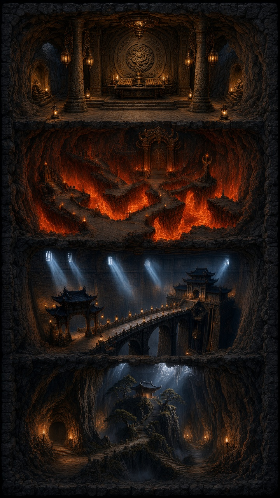

竖构图四层竖井式连通；传送/落差关系。

- 路径：`docs/关卡概念/原画/四层连通总览.jpg`（720x1280） · 用途：总览流线
- 制作：近景岩/建筑 2K；远峰/雾板低模+雾卡；门洞净宽跟场景规范；传送点 `AN_Teleport_*`。

### `ART_concept_blockout_value` · 简化体块·四层明暗总览

体块明暗：冷高山→桥→岩浆热→洞府暖。

- 路径：`docs/关卡概念/原画/简化体块_四层明暗总览.jpg`（720x1280） · 用途：灯光/灰模明暗
- 制作：近景岩/建筑 2K；远峰/雾板低模+雾卡；门洞净宽跟场景规范；传送点 `AN_Teleport_*`。

### `ART_concept_blockout_layers` · 简化体块·明暗分图层

分层明暗板；指导 LIT_ 冷暖包。

- 路径：`docs/关卡概念/原画/简化体块_明暗分图层.jpg`（1280x720） · 用途：LIT 预设参考
- 制作：近景岩/建筑 2K；远峰/雾板低模+雾卡；门洞净宽跟场景规范；传送点 `AN_Teleport_*`。

## 四、古剑同调总览与洞府内景

### `ART_concept_L01_fourzone_gujian` · 四区关卡概念·古剑同调

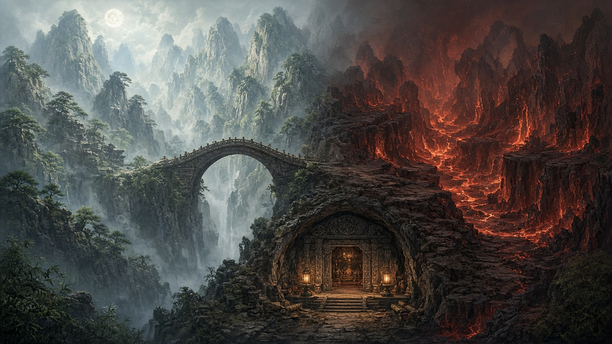

左冷月山雾、右岩浆裂谷、中石桥+洞府门；冷暖对切；古剑同调山海气。四层气质一张总览。

- 路径：`docs/关卡概念/原画/L01_四区关卡概念原画_古剑同调.jpg`（1280x720） · 用途：四层气质总图；非驿站七块

### `ART_concept_L01_grotto_interior_gujian` · 封闭洞府内景·古剑同调

*原图：* `../关卡概念/原画/L01_封闭洞府内景概念原画_古剑同调.jpg`

洞府内景封闭感；烛火暖、石刻、祭坛纵深；古剑同调。文件名含L01为系列编号，语义属洞府内景。

- 路径：`docs/关卡概念/原画/L01_封闭洞府内景概念原画_古剑同调.jpg`（1280x720） · 用途：L04 内景深化

## 五、UI 相关占位

本期原画目录 **无独立 UI 切图**。UI 仍按 `docs/UI资产分类.md` 与总表 `UI_*`（如 `UI_hud_hp` / `UI_result_win`）出线框与 ICON；对话世界锚 `AN_Look_UI_dialogue/menu/choice`。

| 占位 | 说明 |
|------|------|
| 主菜单四键 | 进入/保存/选项/退出 · 世界锚 `AN_Look_UI_menu` |
| 对话框+≤3选项 | 主句≤48字、选项≤16字 · `AN_Look_UI_dialogue/choice` |
| 证据检视框 | `Item.Inspected` |
| 任务短标 | `Arrive` / `Quest.Advanced` |

美术侧待补：古剑向对话框九宫/卷轴边框静帧（UI 岗出，升 `UI_` id）。

---

## 附录 · 面数与 VR 尺度速查

| 类型 | 建议 |
|------|------|
| 主角 | 8k–15k tris · 180cm |
| 鬼怪杂兵 | 4k–8k · 漂浮眼高略高于玩家 |
| 牛头精英 | 12k–20k · 2.8–3.5m |
| 蛇 Boss | 分段 · 头可近看细节 |
| 场景近景 | 可走区碰撞代理+门洞净空 |
| 舒适 | 禁贴脸冲、禁强制连续旋转、禁全屏闪 |
